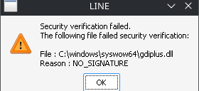

# line-proton

[English](README.md) | 日本語

> **非公式ツールです。** LY株式会社とは一切関係ありません。AI が書いた「やっつけ仕事」(いわゆる slop)の便利ツールで、無保証です。PR は歓迎します。詳しくは [CONTRIBUTING.md](CONTRIBUTING.md)(英語)をご覧ください。

公式の LINE デスクトップアプリを、Proton を使って Linux で動かします。[Faugus Launcher](https://github.com/Faugus/faugus-launcher) 経由でも、単体でも使えます。

## なぜ必要なのか

Windows 版 LINE は、読み込むシステム DLL がすべて Microsoft の署名付きかどうかを確認します。Wine の DLL には署名がないので、こうなります:



なんとか起動できても、LINE が自分を「修復」してしまい、起動するたびにログアウトされます。さらに Proton は、起動のたびに DirectX 関連の DLL をプレフィックスにコピーし直します。

## クイックスタート

```bash
mkdir -p ~/.local/bin && curl -fsSL https://github.com/pan-daniel/line-proton/releases/latest/download/line-proton_linux_amd64.tar.gz | tar -xz -C ~/.local/bin line-proton && ~/.local/bin/line-proton setup
```

セットアップがすべて自動で行い、最後に LINE のインストーラーが開くので、そのまま進めてください。Noto フォントが足りない場合は、インストールに必要なコマンドを表示します。

## ログインについて

> **メールアドレスとパスワードでログインし、ログイン状態を保持するチェックボックスにチェックを入れてください。** QR コードでのログインは記憶されないため、起動するたびにログアウトされてしまいます。

## 必要なもの

- x86_64 の Linux
- Faugus Launcher(ネイティブパッケージ版、推奨)または `umu-launcher`。Faugus の Flatpak 版には対応していません。Flatpak 版しかない場合は `umu-launcher` を入れれば、line-proton が単体で LINE を起動します。
- `~/.local/share/Steam/compatibilitytools.d` にある Proton(Proton-CachyOS や Proton-GE など)
- Noto Sans CJK と Noto Sans Thai

## 動作確認済みの環境

Arch Linux、KDE Plasma(Wayland)、Faugus + Proton-CachyOS で確認しました:

- 再起動してもログイン状態が保たれる
- トーク、絵文字、スタンプ
- スクリーンショットの貼り付け(右クリック → 貼り付け)

音声通話・ビデオ通話はまだ試していません。

## 仕組み

- 「Microsoft Windows」という名前の自己署名証明書を作ります。証明書があなたのマシンの外に出ることはなく、どのトラストストアにも追加されません。
- 使っている Proton をコピーし、Windows の DLL をすべて署名した `Proton-LINE` を作ります。そのため、Proton がプレフィックスにコピーする DLL は最初から署名済みです。
- プレフィックスのシステム DLL に署名し、起動の前後に毎回チェックし直します。
- Proton が更新されていたら、LINE を閉じたあとに `Proton-LINE` を作り直します。
- Windows のフォントを Noto に置き換えて、文字をきちんと読めるようにします。

## コマンド

| コマンド | 内容 |
|---|---|
| `line-proton setup` | インストール、または既存環境の修復 |
| `line-proton launch` | Faugus を使わずに LINE を起動 |
| `line-proton doctor` | セットアップ全体をチェック |
| `line-proton sign` | プレフィックスに署名し直す |
| `line-proton runner build` | Proton が変わっていたら `Proton-LINE` を作り直す |
| `line-proton uninstall` | LINE 本体以外をすべて削除。`--purge` を付けると LINE とトーク履歴も削除します(line-proton が作ったプレフィックスのみ) |

## メンテナンスについて

定期的なアップデートの予定はありません。自分の環境で動かなくなったときに直すだけです。ほかに必要なことがあれば、PR を歓迎します。

## 謝辞

署名の仕組みを見つけてくれた [line-linux](https://github.com/xullul/line-linux) に感謝します。このツールとの違いは、ダウンロードしてすぐ使える単一のバイナリであること、システムの Wine ではなく Proton と Faugus 向けに作られていること、そしてコマンドひとつで全部セットアップできることです。

## ライセンス

[MIT](LICENSE)
