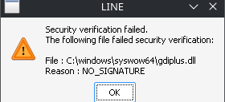

# line-proton

> **Unofficial.** Not affiliated with LY Corporation. This is an AI-written ("slop") convenience tool, provided as-is. PRs welcome, see [CONTRIBUTING.md](CONTRIBUTING.md).

Run the official LINE desktop app on Linux through Proton, with [Faugus Launcher](https://github.com/Faugus/faugus-launcher) or on its own.

## Why

LINE for Windows checks that every system DLL it loads is signed by Microsoft. Wine's DLLs aren't, so you get this:



And when you do get it running, it "repairs" itself and logs you out on every start. Proton adds to the fun by copying its DirectX DLLs into the prefix again on every launch.

## Quick start

```bash
mkdir -p ~/.local/bin && curl -fsSL https://github.com/pan-daniel/line-proton/releases/latest/download/line-proton_linux_amd64.tar.gz | tar -xz -C ~/.local/bin line-proton && ~/.local/bin/line-proton setup
```

Setup does everything, then opens the LINE installer: click through it. If Noto fonts are missing, it tells you the exact command to install them.

## Logging in

> **Log in with email and password and tick "Keep me logged in".** QR-code logins aren't remembered, so you'd be logged out every time you start LINE.

## What you need

- x86_64 Linux
- Faugus Launcher (native package, recommended) or `umu-launcher`. The Faugus Flatpak isn't supported; with it, install `umu-launcher` and line-proton runs LINE on its own.
- A Proton in `~/.local/share/Steam/compatibilitytools.d`, e.g. Proton-CachyOS or Proton-GE
- Noto Sans CJK and Noto Sans Thai

## What's been tested

Arch Linux, KDE Plasma on Wayland, Faugus with Proton-CachyOS:

- staying logged in across restarts
- chats, emoji and stickers
- pasting screenshots (right-click → Paste)

Voice and video calls haven't been tried yet.

## How it works

- Creates a self-signed certificate named "Microsoft Windows". It stays on your machine and is never added to any trust store.
- Builds `Proton-LINE`, a copy of your Proton with every Windows DLL signed, so whatever Proton copies into the prefix is already signed.
- Signs the prefix's system DLLs and checks them again around every launch.
- After LINE closes, rebuilds `Proton-LINE` if your Proton got updated.
- Maps Windows fonts to Noto so the text is actually readable.

## Commands

| Command | What it does |
|---|---|
| `line-proton setup` | Install, or repair an existing install |
| `line-proton launch` | Start LINE without Faugus |
| `line-proton doctor` | Check every part of the setup |
| `line-proton sign` | Re-sign the prefix |
| `line-proton runner build` | Rebuild `Proton-LINE` if your Proton changed |
| `line-proton uninstall` | Remove everything except LINE itself; `--purge` also deletes LINE and your chats (only from a prefix line-proton set up) |

## Maintenance

I'm not planning regular updates. I'll fix things when they break for me personally. If you need something else, PRs are welcome.

## Kudos

Big thanks to [line-linux](https://github.com/xullul/line-linux), which figured out the signing trick. This one differs in that it's a single binary you download and run, it's built around Proton and Faugus instead of system Wine, and one command sets everything up.

## License

[MIT](LICENSE)
